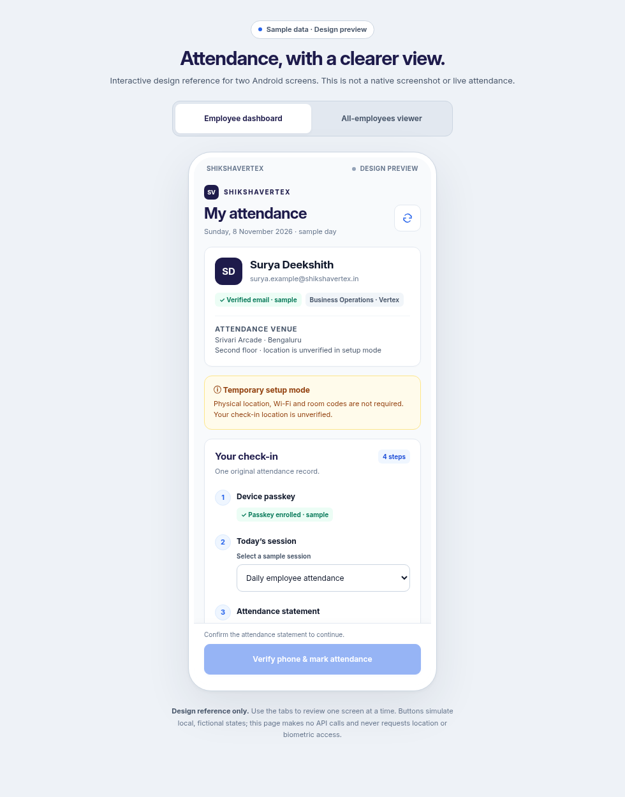
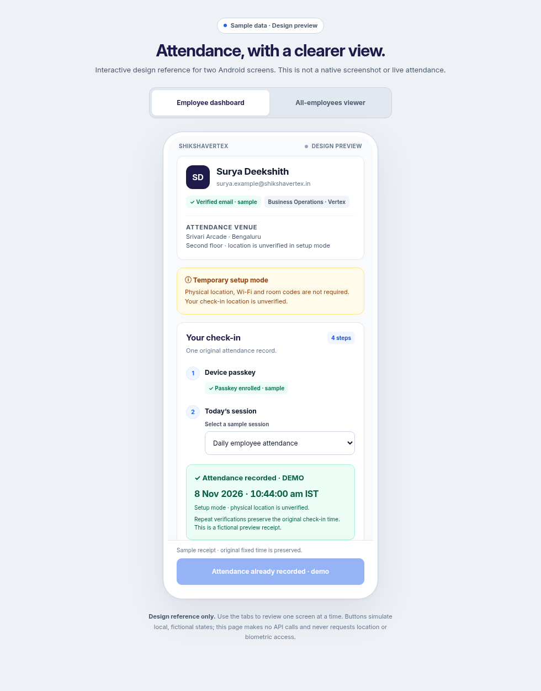
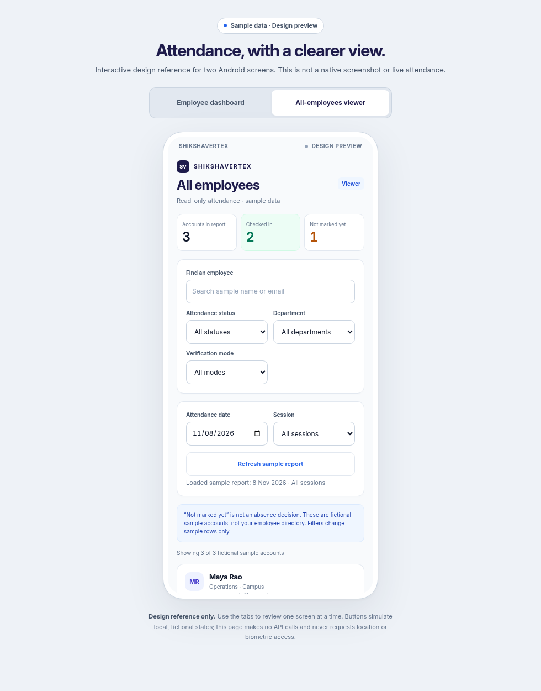

# Android attendance: first two views

This iteration implements the **Android Employee Attendance Dashboard** and **All-Employees Attendance Viewer** from the supplied design brief. Other onboarding, HR management and web layouts are reserved for later iterations.

Open [the interactive design reference](android-attendance-preview.html) locally in a browser. Its two tabs let you review one screen at a time. It uses labelled fictional records and fixed demo timestamps, makes no API calls, and does not start location sharing or phone verification. It is a design reference, not a screenshot of a running Android device. The bundled Inter font is relative to the repository; if you download only the HTML, the browser uses a local sans-serif fallback.

## Employee Attendance Dashboard

The native screen provides an identity/verified-email card, venue details, amber setup-mode banner, passkey status, session picker, consent statement and sticky check-in action. Status comes from the existing authenticated APIs. Onsite prerequisites are snapshots checked on refresh and again on submission; they are not fabricated continuously connected indicators. Six-digit room codes remain aligned with server validation.

After check-in, the card shows the original server-recorded time in India time, including seconds. Repeated verification never substitutes a new timestamp. Receipt hydration filters admin summaries to the signed-in UID and retains today's recorded sessions even after HR closes them. A successful check-in whose follow-up refresh fails still gets a receipt with a retry action. Loading and recoverable errors are visible; actions are disabled during requests and the submit button stays disabled when prerequisites are missing or attendance is already recorded.

Location sharing is a separate collapsed card with its workday window, explicit consent and Start/Stop controls. Opening the dashboard or marking attendance does not start sharing. Status text follows the actual foreground service. The existing persistent Android notification remains the stop control when the app is away. Authorized users have compact role navigation to attendance viewing or the existing HR controls.

## All-Employees Attendance Viewer

The native screen shows registered/recorded account counts, checked-in and not-marked counts, date/session selection, an explicit refresh action, search, status chips and collapsed department/team/verification-mode filters. Employee cards use initials, names/emails, department/team, original check-in times and evidence labels. Scope edits are labelled as unapplied until refreshed. An empty date, no matching filters, unavailable time and access-denied refresh have distinct states. Failed refreshes remove displayed records and metrics rather than retaining a denied snapshot.

“Not marked yet” does not assert absence, leave, lateness or payroll. Counts do not pretend the entire unregistered directory is an expected-attendance roster. Onsite GPS cannot prove a floor. Phone and venue Wi-Fi badges are separate explicit booleans projected from existing persisted evidence; raw credentials, network identifiers and coordinates are not exposed. Setup check-ins remain location-unverified. CSV export remains in the existing web dashboard; this native view does not show a nonfunctional export button.

## Implementation and validation

- `AttendanceUi.kt` supplies shared native tokens: indigo, royal blue, alabaster canvas, 12dp white cards, semantic light backgrounds with dark readable text, Inter typography and tabular numerals. Touch targets are at least 48dp, labels wrap, status is expressed in words, and insets account for status/navigation bars, cutouts and the keyboard.
- `EmployeeDashboardScreen.kt` and `AttendanceViewerScreen.kt` are native Android Views, wired through `MainActivity` to existing authentication, passkeys, attendance, location consent, role controls and reports.
- Pure presentation tests cover own-account original receipts, closed sessions, invalid times, filtering, mode distinctions, initials and IST formatting. Backend tests cover evidence projection and omitted sensitive fields.
- The HTML reference is tested in headless Chrome for consent gating, receipt preservation, navigation, filters and 360px overflow. The sample images above come from that reference, not a native emulator or the user's phone.
- This is version **1.5** source. Local APK build/test/lint validation does not resolve the existing missing version 1.2 signing keystore. The CI signing guard is retained; publishing an in-place APK update still needs that original key or a deliberately managed migration. No private signing key is committed or requested in chat.

Physical-phone checks still needed: narrow screen/large text, Android 16 system insets, TalkBack order, Credential Manager success/cancellation, permission denial, setup/onsite transition, Wi-Fi drop, first receipt after HR closure, viewer revocation and foreground-service stop. The app does not claim a phone test based on the HTML reference.
