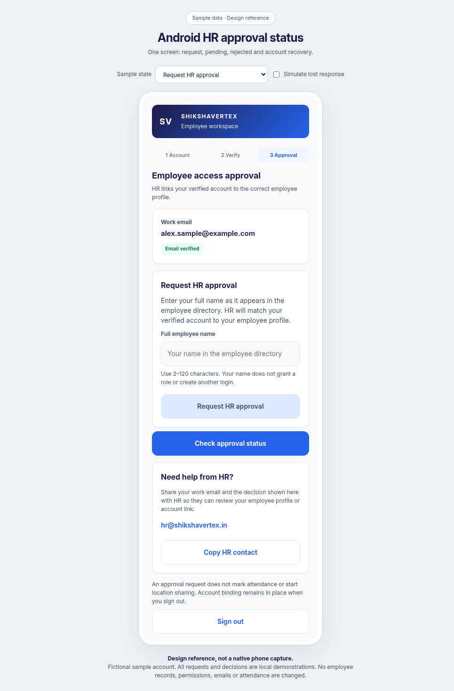
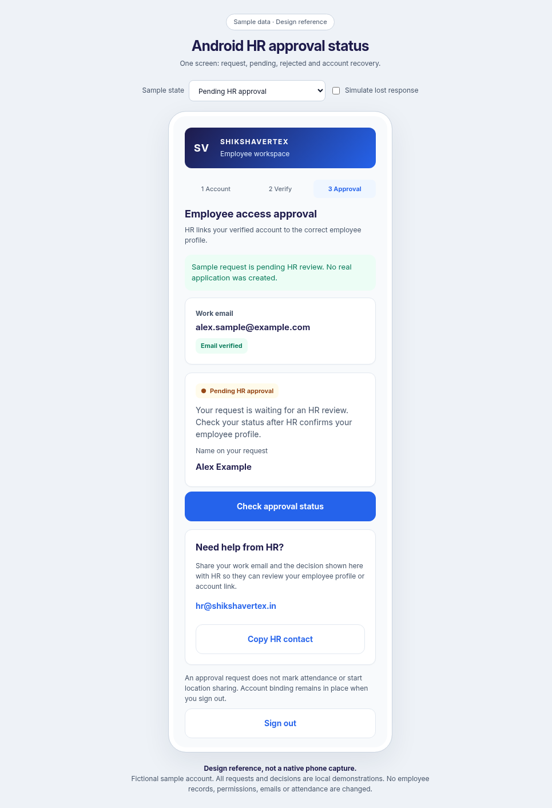
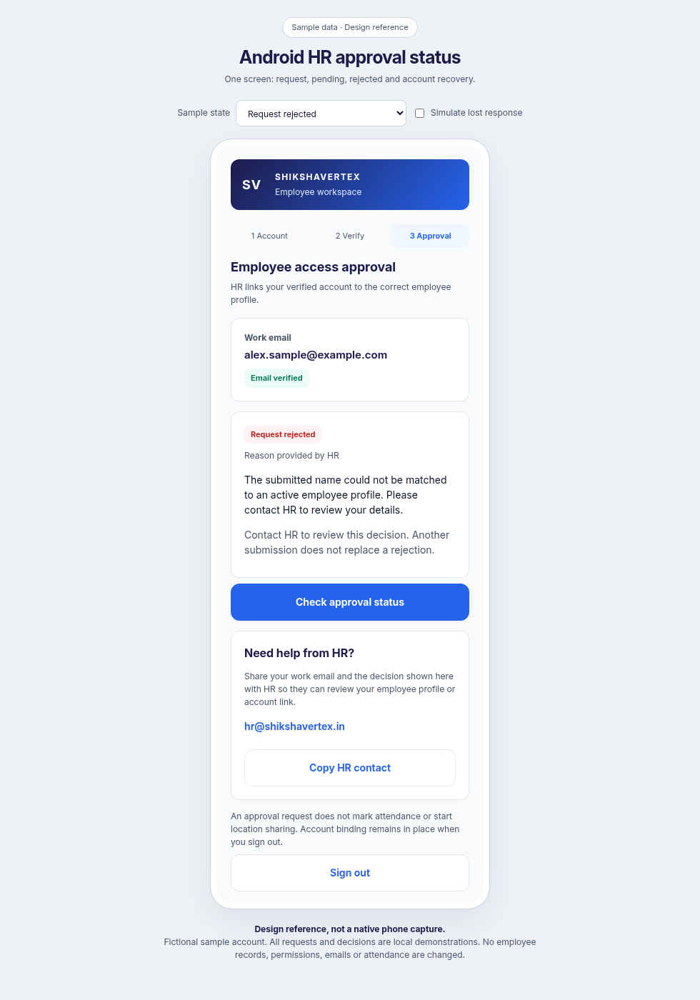
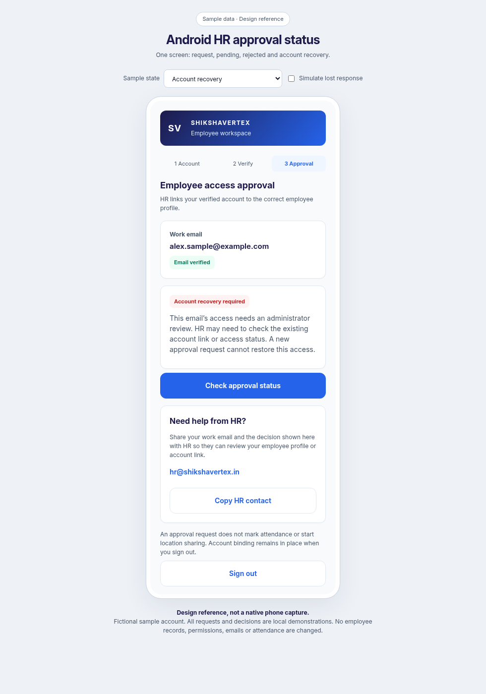

# Android HR approval status

This iteration finishes only `EmployeeApprovalScreen` and its request/status callbacks. It reuses the shared Inter typography, indigo/blue brand, white cards and stepper. Existing Firebase verification, server approval, authenticated sessions, venue checks, account binding and role assignments remain authoritative.

Open [the interactive reference](android-approval-preview.html) and select one sample state at a time. It uses fictional records and local simulations only. The request, status check, contact-copy and sign-out actions do not contact an API, change permissions or send an email in this reference. Images are browser design references, not native Android captures.

## Request

Only a consistent, explicit `approved: false, status: not-requested` response offers the name form. It accepts a trimmed 2–120-character name, supports Unicode/punctuation, links the visible label for accessibility and supports the keyboard Done action. Submission and all other actions are disabled while a request is running. The request uses the existing `POST /registration/request`, then fetches the current decision.

## Pending

An amber status and decorative pulsing dot identify pending review. The requested name is shown only when returned by the service. There is no duplicate form. Status checks are explicit and show a loading label. The pulse respects disabled Android animations and is cancelled when detached.

## Rejected

A red status displays HR's actual rejection reason as selectable plain text. If the service supplies no reason, the screen says so. It never displays the JSON null sentinel as a reason. A status check and HR contact remain available; another request is not offered.

## Account recovery

The server's `access-unavailable` state explains that HR must review the account link or access status. The UI does not guess whether the cause was revocation or a UID mismatch. It does not provide a new approval form or erase the existing binding. The native Copy HR contact action copies `hr@shikshavertex.in` to Android's clipboard, and never sends an email automatically.

Unknown, missing or contradictory status fields show “Status not confirmed” with a status-check action. They do not imply rejection or approval. A failed status refresh removes the request form. If the request endpoint responds but the following status fetch fails, the UI explains that distinction and requires a status check before offering another submission. An uncertain network result also suppresses repeat submission until status is fetched. Server validation errors retain the editable form. The server's existing idempotency and access checks remain in place.

A consistent approved response displays a green confirmation and continues through the existing forced-token-refresh/session flow. If account access then fails, approval stays distinct from the error and Continue to account permits retry. The email-verified badge uses the current Firebase profile; it does not grant attendance or HR access.

Validation completed: Kotlin compilation, 30 Android unit tests and 38 existing backend tests passed. Android lint reported 0 errors and 18 warnings in the current working tree. Browser reference checks passed for name validation, busy controls, the four requested states, unknown/approved safeguards, a lost submission response followed by status recovery, and all six states at 360px including a long requested name. No live accounts, records or emails were changed. No APK was assembled and nothing was deployed.

Physical-phone checks remain: TalkBack order, large-font/keyboard layout, clipboard feedback, and an actual HR approval/rejection followed by an authenticated status refresh.
