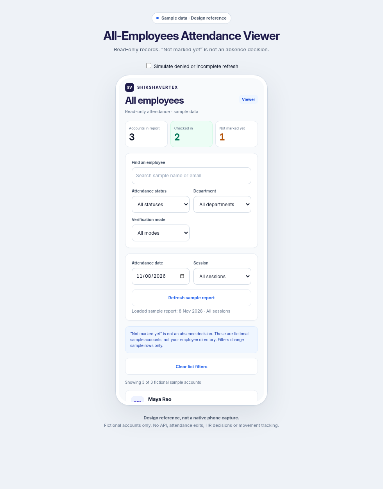
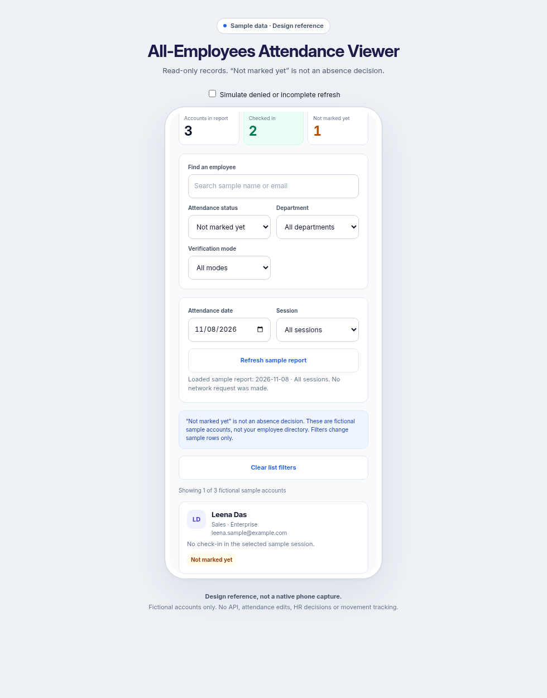

# Android All-Employees Attendance Viewer review

This iteration finishes only the existing native `AttendanceViewerScreen`, retaining the Inter, indigo/blue, white-card design. Its report request remains `GET /attendance-report`. The screen provides no attendance edits, approval, override or movement-history controls. Existing server viewer authorization, UID binding and revocation checks remain unchanged.

Open [the single-screen reference](android-attendance-viewer-preview.html) for fictional records and local demonstrations. It calls no APIs or location services. These images are browser design references, not native phone captures.

“Not marked yet” means there is no recorded check-in for the loaded date/session. It does not establish absence, leave, lateness, payroll or work hours. Counts cover current approved registered accounts and historical recorded accounts, not the entire unregistered employee roster. Counts describe the loaded scope; local list filters do not alter them. A date with no attendance sessions has a separate explanatory state.

Search, status, department, team and verification-mode filters now survive a successful refresh. Department/team selections that no longer exist in the newly loaded scope reset to All. Clear list filters resets them deliberately. Session/date scope is still applied through an explicit refresh. Verification-mode filters only match actual recorded check-ins, so combining a mode with Not marked yet can produce an empty list without changing the cohort totals.

Report validation checks the requested date/session, event references, row structure, marked/check-in consistency, explicit evidence booleans and totals before displaying a new report. Missing or contradictory data cannot become unmarked accounts or fabricated zero totals. Legacy invalid timestamps remain unavailable while retaining their recorded status. Setup, onsite, override and legacy evidence remain distinct; a missing verification flag never becomes a verified badge.

A denied, failed or invalid refresh hides previous records, metrics and list-filter metadata. Changing a local filter cannot restore that denied snapshot. Refresh/date selection remain available for recovery, and a successful new report restores the view. No export button is invented: the existing web attendance CSV is described in the footer.

Validation passed: Kotlin compilation, all 47 Android unit tests, and 37 targeted backend tests for read-only access/revocation and evidence projection. New unit coverage checks report-state consistency and timestamp fallback. Browser-reference checks passed for filtering, refresh preservation, reset, session counts, denied/incomplete snapshot clearing, retry and 360px layout. Final lint reported 0 errors and 17 warnings in the current working tree. No APK was assembled, nothing was deployed and no live employee or attendance records were changed.

Physical-phone checks remain: Android 16 insets/date picker, large fonts/TalkBack, spinner/filter preservation on refresh, real viewer revocation, network failure and recovery. The reference uses only its fixed sample day and does not establish native device behavior.
