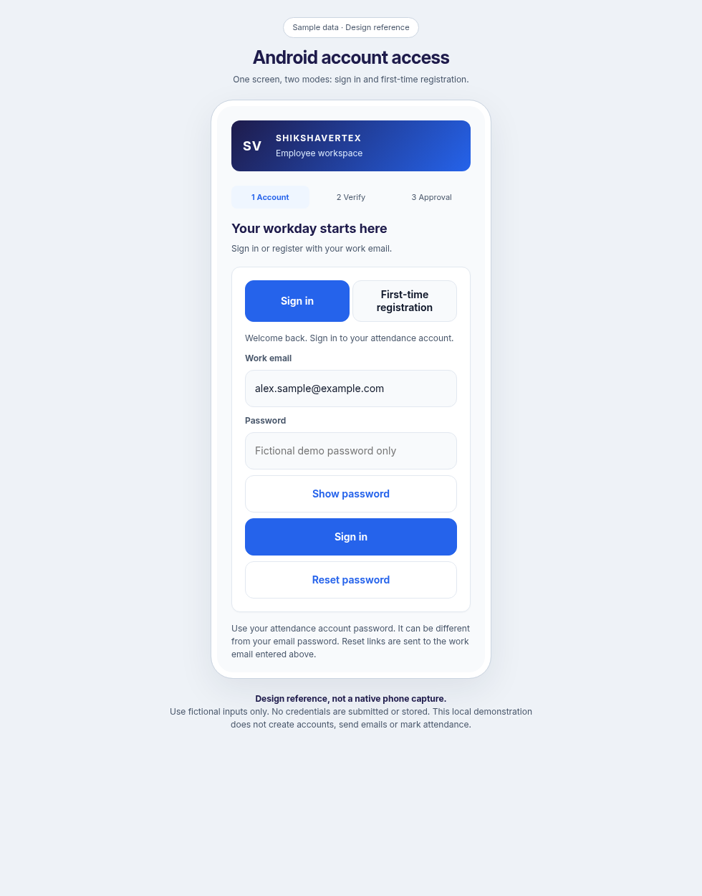
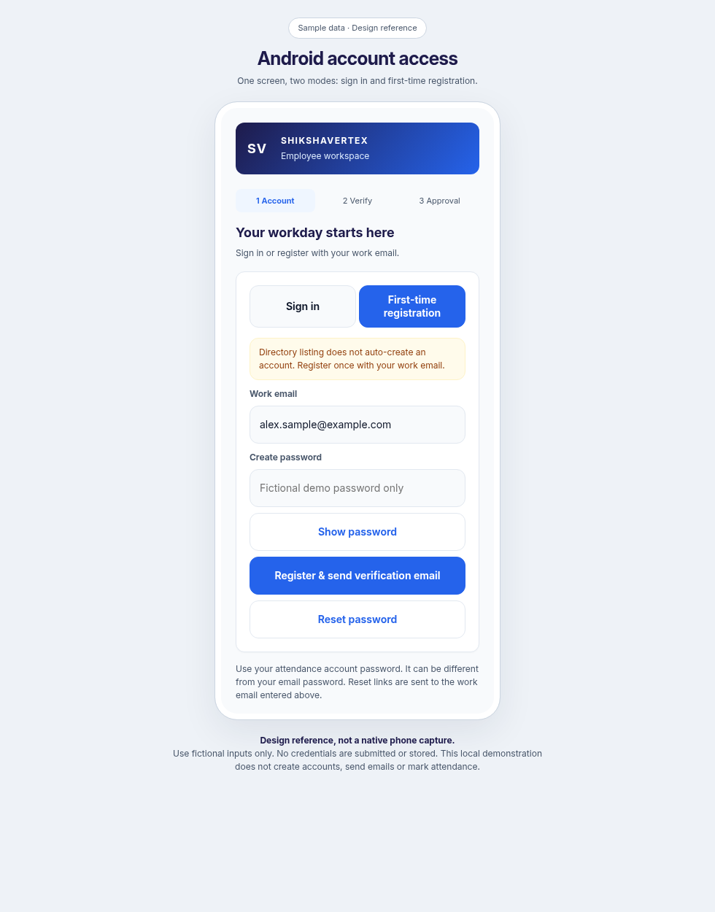

# Android sign-in and registration

This iteration finishes the existing `AuthScreen` in `AccessScreens.kt`. It preserves the Firebase sign-in, account creation and reset-password calls in `MainActivity.kt`. It does not grant attendance access: existing email verification, HR approval, account binding and venue rules still apply.

Open [the account-access reference](android-auth-preview.html) to review the two modes. It uses fictional input and local demonstrations only. It does not contact Firebase or any attendance API. The images below are browser design references, not native Android captures.

The screen uses the existing Inter font, indigo/blue brand header, white card, selected mode buttons and amber registration helper. Errors identify and focus the relevant field. Email and password have linked accessibility labels, autofill hints and Next/Done keyboard actions. Passwords remain unchanged when submitted, are hidden during requests and cleared when switching modes, leaving the app or signing in successfully. The show/hide button resets its text and accessibility description together. Password reset needs a valid email but does not require a password.

Reset success gives neutral account-existence feedback with inbox/spam instructions. Existing-account, invalid-credential, disabled-account and network failures give appropriate recovery guidance. All actions and fields are disabled while a request is running; Firebase and the backend remain authoritative.

Validation for this iteration uses Kotlin compilation, existing Android unit tests, Android lint and browser checks of this labelled design reference. No APK assembly or deployment is requested. Native keyboard, password-manager autofill and TalkBack checks on a physical phone remain to be performed.

Completed checks: Kotlin compilation succeeded; all 22 existing Android unit tests passed; lint reported 0 errors and 18 warnings in the current working tree. Browser reference checks passed for password visibility and mode clearing, invalid-input focus, busy controls, reset without a password, and 360px layouts for both modes. No authentication or attendance API calls were made by the reference. Gradle did not run APK assembly or packaging tasks.
