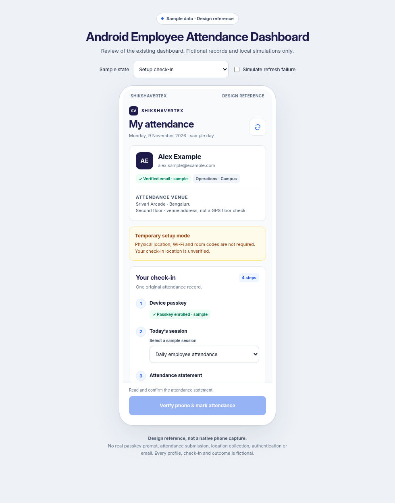
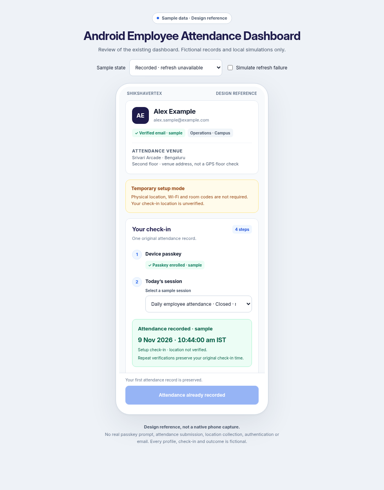

# Android Employee Attendance Dashboard review

This iteration reuses and finishes the existing `EmployeeDashboardScreen`; it does not replace the dashboard or start work on another screen. Inter typography, indigo/royal blue actions, white cards, amber setup mode, the guided check-in steps and sticky action bar remain.

Open [the single-screen reference](android-employee-dashboard-preview.html) to inspect setup/onsite check-in, no session, enrollment needed, refresh failure, recorded/closed sessions, an unavailable follow-up refresh, date rollover and cancellation. Every outcome is a local simulation using fictional records. The reference makes no API calls or real passkey requests and collects no locations.

## Changes

- A failed attendance refresh or failed Wi-Fi recheck invalidates new check-in controls. An amber notice asks for a successful refresh; cached receipts retain their original timestamps. Current GPS/Wi-Fi badges describe what was observed on refresh, with the existing fresh native/server checks still required on submission. GPS continues to make no floor claim.
- Session choice is retained when refreshing; the new dashboard still requires a fresh statement and room code. A recorded session remains selectable after HR closes it and is labelled closed/recorded. A closed session cannot accept a new check-in.
- A dashboard loaded on an earlier India date blocks new attendance and asks for refresh. A small date check runs while the view is attached and stops when it detaches. The actual submission handler also evaluates the current date; server session/date rules remain authoritative.
- A confirmed check-in whose follow-up dashboard fetch fails uses the existing designed dashboard to display the server's receipt. Its original time and stored verification evidence are preserved. Other new check-ins stay blocked until refresh succeeds. Cached identity/receipt fallback is restricted to the current Firebase UID; it does not grant access. A minimal receipt remains as a defensive fallback when no matching dashboard model is available.
- Passkey cancellation and a missing credential have readable recovery guidance. Room-code input has a linked accessibility label and remains aligned with the server's six ASCII-digit validation.

The existing authentication, role controls, attendance APIs, phone passkey proof and separate location-sharing module retain their behavior. Setup attendance does not collect GPS or require Wi-Fi/room codes; passkey verification and the attendance statement still apply. Opening the dashboard or checking in does not start location sharing.

## Validation

Kotlin compilation and all 35 Android unit tests passed. Added checks cover setup prerequisites, stale/day-changed dashboards, missing/closed sessions, onsite GPS/Wi-Fi/room-code prerequisites, and original receipts during an unavailable refresh. The existing 43 targeted backend attendance/passkey tests also passed, including duplicate submissions preserving the original record. Lint reported 0 errors and 18 warnings in the current working tree.

Browser reference checks passed for the nine sample states, statement reset when changing session, busy controls, original receipt preservation, cancellation and 360px layout with the action bar anchored. Images are browser design references, not native phone captures. No APK was assembled, nothing was deployed, and no live accounts, emails or attendance records were changed.

Native phone checks remain: Android 16 keyboard/system insets, large text, TalkBack, Credential Manager success/cancellation, denied permissions, a Wi-Fi drop, day rollover, and a real successful submission followed by an interrupted refresh.
