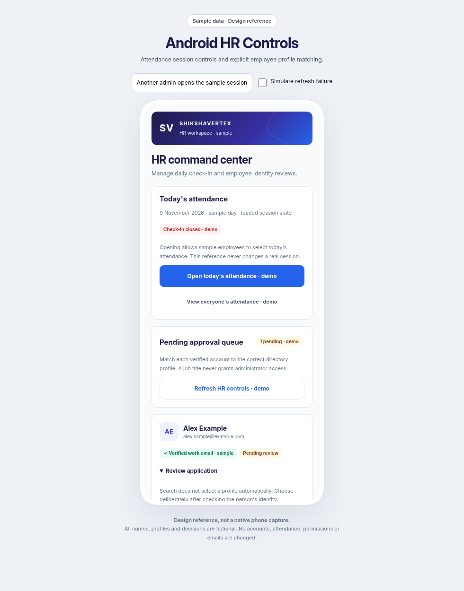
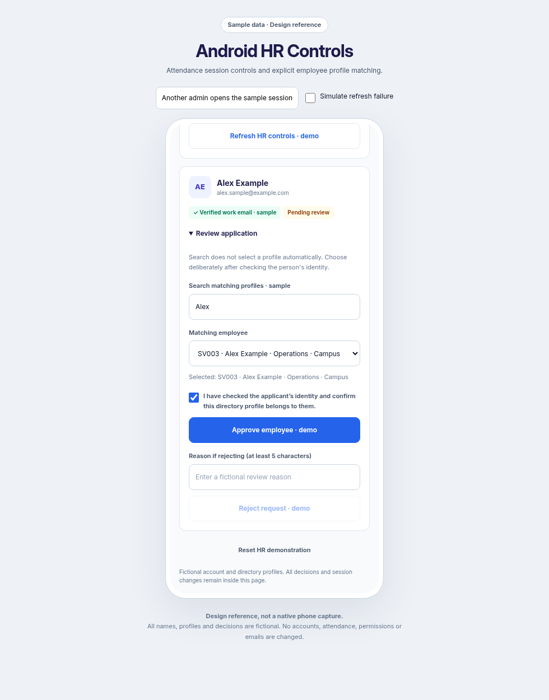

# Android HR Controls

This iteration finishes only the existing native `HrControlsScreen` and its attendance/approval callbacks. The Inter, indigo/royal blue, white-card design is retained. The screen remains restricted to the authenticated committee/HR-admin role; job titles and attendance-viewer access do not grant approval permissions.

Open [the interactive HR Controls reference](android-hr-controls-preview.html) to review the session and explicit matching workflow. All records/actions are fictional local demonstrations. No APIs, emails, permissions, live approvals or attendance records are changed. These images are browser design references, not native phone captures.

The attendance action applies the explicit loaded intent: Open sets the session open, Close sets it closed. A second administrator applying the same change does not cause the action to invert. The latest event identity is checked before mutation. Day rollover, a replaced event, or multiple ambiguous daily sessions requires review/refresh. Closing preserves existing check-ins. The existing event APIs remain authoritative. This screen does not add a server uniqueness constraint for concurrent creation of daily events; ambiguous daily sessions are blocked when detected and need review in the web portal.

Each pending application expands into a profile search/picker, selected-profile summary and explicit identity-confirmation checkbox. Search includes employee ID, name, designation, department and team and never selects a profile automatically. Changing the search or selection resets confirmation. Approval requires a selected active profile, compatible UID/email bindings, a verification flag on the request and the checked identity statement. The selected profile's ID, name, department, team and designation remain visible for comparison. This is a human identity review; matching names alone is not proof.

Rejected requests require a 5–300-character reason. All request controls are disabled during operations. The server still revalidates authorization, pending state, profile activity and UID/email collisions in its approval transaction. No client-side selection bypasses that transaction or grants HR privileges.

A successful mutation followed by a failed refresh reports that the change was saved. Stale application/profile data is removed and further mutations require a fresh load. A failed or uncertain write also clears mutation controls and asks for refresh rather than inviting blind resubmission. Refresh remains available, as do Back and authorized attendance navigation.

Kotlin compilation and all 45 Android unit tests passed. Added tests cover compatible and conflicting identities, inactive/malformed profiles, and preserving the loaded session intent. The existing 38 targeted backend tests passed. Android lint reports 0 errors and 17 warnings in the current working tree. The reference passed session open/close with another simulated administrator, explicit profile confirmation/reset, saved-decision refresh failure, rejection-reason requirements and 360px layouts with no API calls.

No APK was assembled and nothing was deployed. Physical-phone checks remain: large fonts/keyboard/TalkBack, two real administrator devices, actual approval/rejection and refresh after an interrupted network request.
