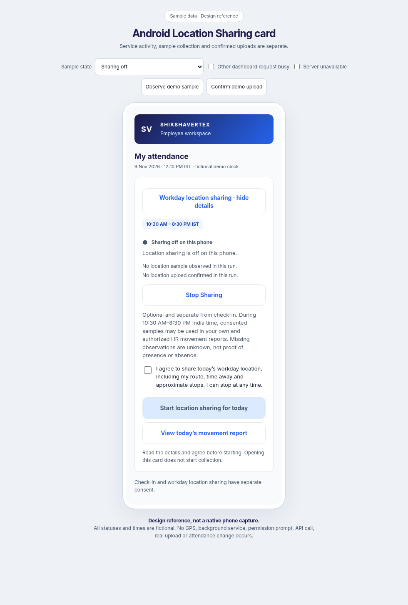
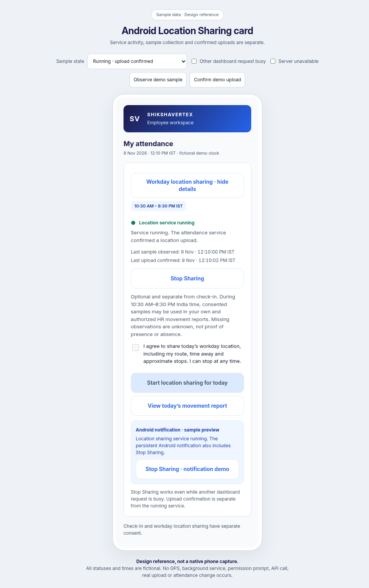
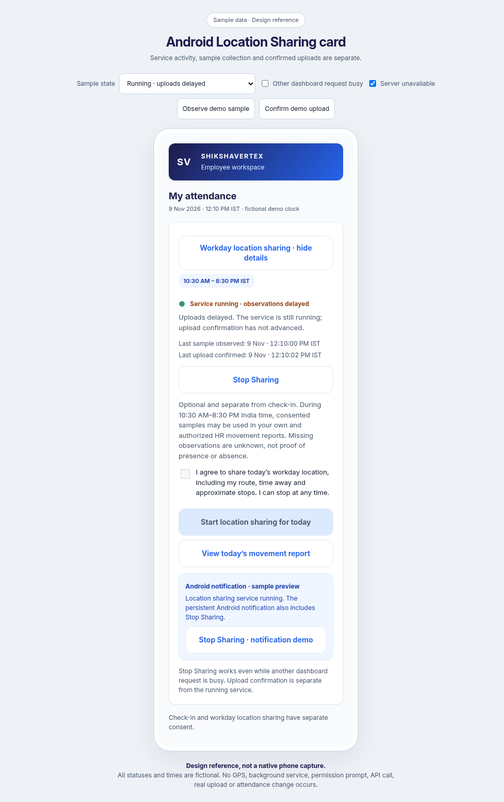
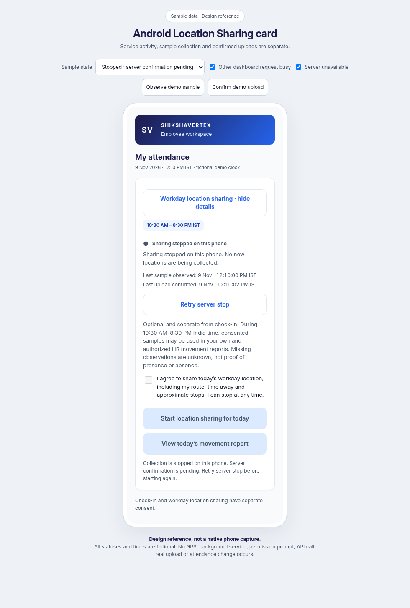

# Android Location Sharing card

This iteration finishes the existing location-sharing module, including the card, its Activity callbacks and the foreground service state it displays. Authentication, account binding, attendance rules, role permissions and the existing tracking API request/response shapes remain in place. No other screen is redesigned.

Open [the interactive card reference](android-location-sharing-preview.html) to review one module at a time. It uses fictional sample times and local state simulations. It starts no Android service, requests no permissions, collects no locations and makes no API calls. These images are browser design references, not native phone captures.

## Explicit consent and startup

The card starts collapsed. Opening it or checking attendance does not begin sharing. It explains the 10:30 AM–8:30 PM India-time window and that opted-in samples can describe routes, time away and approximate stops in the member's and authorized HR reports. Missing observations remain unknown rather than attendance or absence evidence.

Start requires a fresh checked consent statement, a verified signed-in account, the workday window, precise-location permission and enabled notifications. The Activity waits until it is resumed and venue access is available, confirms today's consent through the existing API, and starts a visible location foreground service. The service independently validates today's active consent before registering location callbacks. Consent saved on the server alone is never displayed as active phone collection.

The statement clears on start/stop/failure so it cannot silently authorize a later retry. Start is unavailable while another sharing run or an unconfirmed server stop is outstanding. The service uses `START_NOT_STICKY` and a current in-memory run token; a null/old restart intent cannot start collection after a process kill or boot. There is no automatic daily start.

## Actual status and upload evidence

`SharingStateStore` supplies typed states for off, starting, waiting for location, active collection, delayed observations, stopped and startup/session errors. A green pulsing dot indicates the local collector is running; waiting/delayed text still states what is missing. Animation respects Android's animation setting and is cancelled when detached. The card shows last sample time separately from last confirmed upload time. Neither a local sample nor a failed upload advances upload confirmation.

An upload is acknowledged only after the existing API confirms the entire batch as accepted/duplicate samples. Sign-in/UID checks run before collecting and uploading. The card projects timestamps and messages only to the corresponding signed-in UID; it exposes no coordinates or credentials. The notification preview is shown only once the service has registered its collector. The real Android notification includes Stop Sharing.

Loss of connectivity may leave collection running with a delayed-upload state. The existing memory-only queue retains at most 30 recent samples, expires samples after five minutes and drops off-hours data. Unconfirmed or missing intervals can become unknown report gaps. Permission, notification or sign-in changes and the end of the daily window stop collection. Returning to the app or reconnecting never starts a stopped run without another explicit consent action.

## Stop Sharing

Stop Sharing sits above the expandable consent details and is independent of dashboard busy/venue gating. The card, locked-app stop control and notification action all use the same local stop path: cancel a pending start/permission continuation, invalidate its run token, remove provider callbacks, clear queued points, remove the notification and stop the service before waiting for network confirmation.

Server confirmation is separate. If unavailable, the UI continues to state that collection is stopped on this phone and offers Retry server stop. Start remains disabled until that stop is confirmed. Repeated stop taps share the pending confirmation, and a pending consent request is settled/cancelled before its server session is closed. Old provider/upload/stop responses cannot revive or overwrite a newer run. Already accepted server records are retained; stopping cannot retract an upload that had already reached the server.

## Validation

Kotlin compilation and all 42 Android unit tests passed. New state tests cover consent versus collection, sample versus upload evidence, delayed uploads, immediate local stop, stale callbacks, server-stop retries, startup failure and UID isolation. Existing queue/workday tests cover bounded samples, clearing and the India-time window. All 11 backend tracking tests passed, including explicit consent, owner/device restrictions, stopping rejecting further uploads, renewed consent and unknown gaps.

The labelled browser reference passed explicit-consent/start cancellation, Stop during another busy request, waiting/sample/upload separation, offline collection, the notification Stop simulation, pending server confirmation, fresh consent after stop and all nine states at 360px. Lint reported 0 errors and 17 warnings in the current working tree. No APK was assembled, nothing was deployed and no live location, employee or attendance records were changed.

Physical-phone validation remains: Android 16 permission dialogs and activity recreation, foreground-service start restrictions, actual notification Stop, revoking notifications/location while running, network loss/reconnection, backgrounding, force-stop, and the 8:30 PM cutoff. Browser references and pure state tests do not establish native device behavior.
