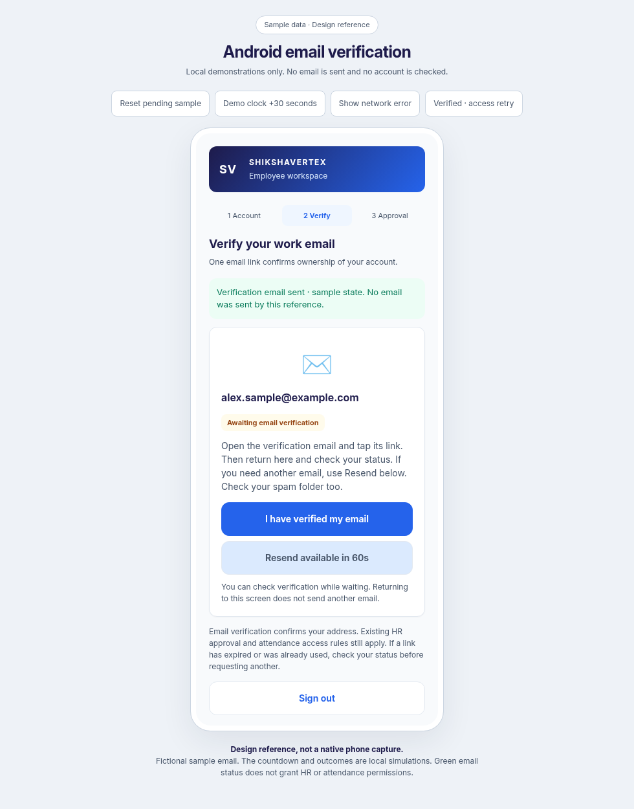
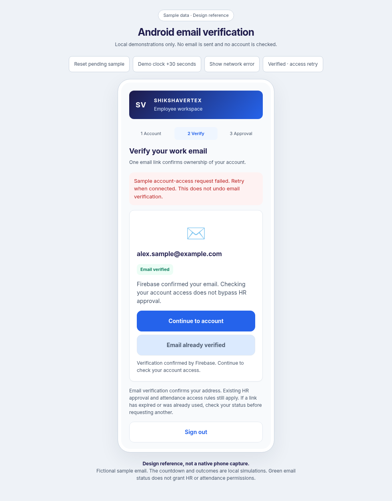

# Android email verification

This iteration finishes only `VerificationScreen` and its Firebase verification/resend wiring in `MainActivity`. Existing sign-in, HR approval, account binding, venue rules and attendance APIs retain their authority.

Open [the interactive reference](android-verification-preview.html) for the waiting, resend, network-error and verified-email/account-access-retry states. Its buttons and clock are local demonstrations. It sends no emails, checks no real accounts and makes no API calls. These images are browser design references, not native Android captures.

The screen uses the existing Inter font, indigo/blue brand and white card. The second step is selected. Waiting/unverified states are amber; Firebase-confirmed verification is green; request failures appear as red, retryable messages. The decorative mail pulse respects Android animation settings and stops when detached. Countdown updates are not announced every second.

Verification checking stays available during the resend cooldown. Checking, sending and idle controls have distinct labels. All request actions are disabled during work. A successful reload must report `isEmailVerified` before the existing forced-token-refresh/session flow proceeds. Verification itself does not grant HR privileges or attendance access. If account access fails after email confirmation, the green email status stays separate from the error and a Continue action allows retry.

The 60-second local resend cooldown is saved per Firebase UID using private app preferences. Returning from the email app, recreating the activity or reopening the app does not restart the minute or automatically send mail. Elapsed time handles wall-clock rollback, and wall time covers time away/restart. This is UI pacing, not a security rate limit: Firebase remains authoritative and can require a longer wait. An ordinary failed email request does not claim that an email was sent; Firebase throttling starts a local wait with an explicit explanation. Only timestamps and UID-scoped keys are stored for this cooldown, not verification links or passwords.

Validation: Kotlin compilation and 26 Android unit tests passed, including countdown expiry, restoring saved timestamps, clock rollback and restart cases. Android lint reports 0 errors and 18 warnings in the current working tree. Browser reference checks cover checking/sending busy states, pending feedback, countdown expiry/resend, network retry, the email/access distinction and 360px/long-email layouts. No APK was assembled and nothing was deployed.

Physical-phone validation remains: receiving/opening a real verification email, returning to Android 16, process recreation, TalkBack, and actual Firebase throttling/offline responses. No real email was sent during automated checks.
