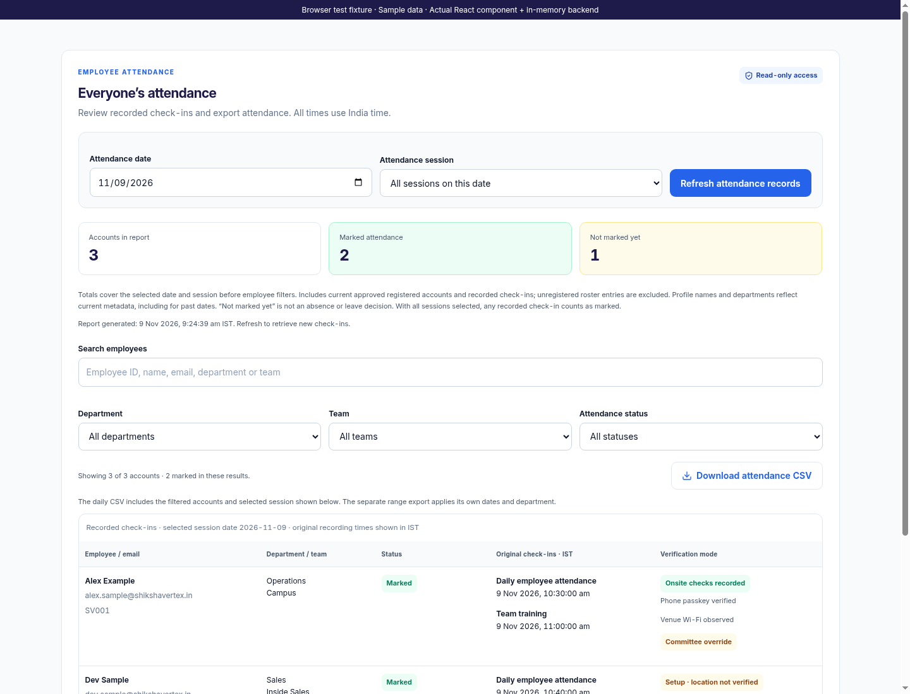
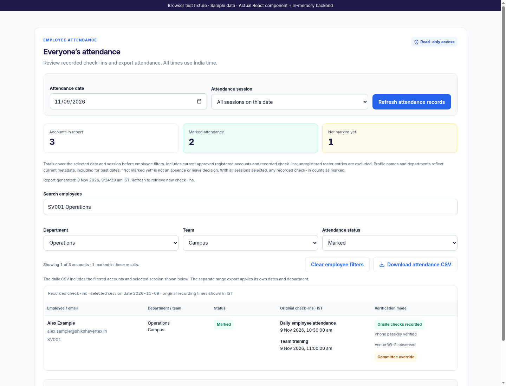
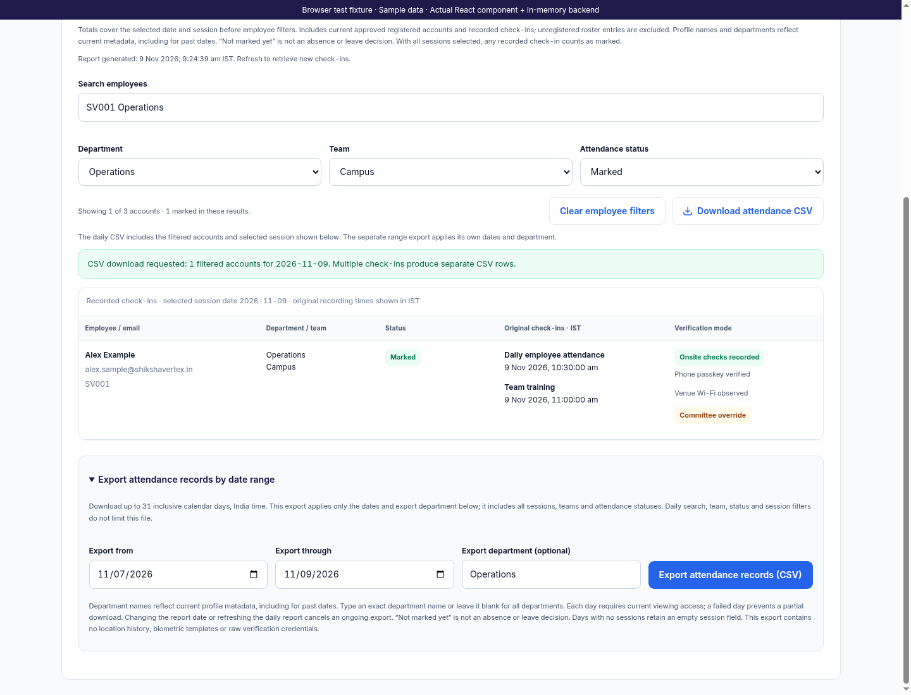
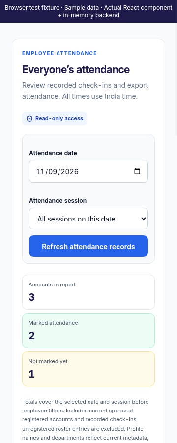
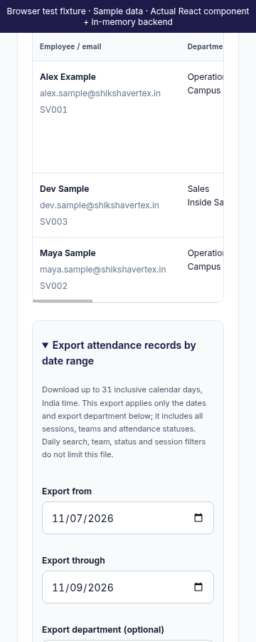
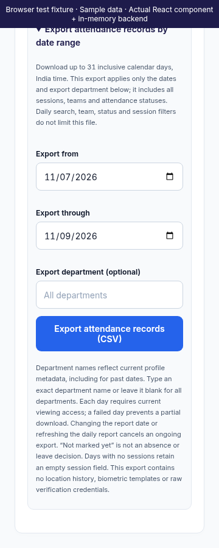
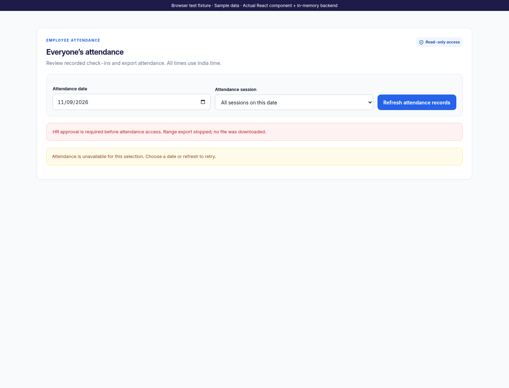

# Web All-Employees Attendance

This iteration finishes only the existing `AttendanceDashboard` and its `AttendanceRangeExport` panel. Authentication, read-only viewer/HR authorization and the existing per-day `/attendance-report` API are unchanged. No server routes, Android screens or other web screens changed. The App integration test fixture now returns the date requested by the report API.

The screen retains the Inter, indigo/royal-blue and white-card interface, with green recorded states, amber “Not marked yet” states and red errors. Date and session select the server report. Employee-ID/name/email/department/team search supports multiple case-insensitive terms. Department, team and status filters combine locally. Changing department clears the team filter; employee filters otherwise survive refreshes and date changes. Clear employee filters resets those filters without changing the date/session. Report totals describe the whole selected date/session; the result count separately describes filtered accounts.

“Not marked yet” remains distinct from absence or leave. Counts include the API's current approved registered accounts and recorded check-ins, excluding unregistered roster entries. Profile metadata is current, including for past reports. No-session dates retain an explicit no-session message and never produce inferred absence. Original check-in date/time is shown in India time, including when a manual record was made on another day. Manual overrides retain their own evidence label even in setup mode. Phone and Wi-Fi badges require the corresponding explicit backend evidence.

Daily CSV downloads use the loaded snapshot's selected session and filtered accounts. Range CSV exports instead apply their own inclusive dates and department, include all sessions/teams/statuses and support up to 31 calendar days. The selected daily department initially fills the export department; it remains editable for the range. Exact department matching ignores case and surrounding whitespace. Suggestions come from loaded report metadata, and an exact department from another day can be typed. No match produces a labelled header-only CSV.

The range exporter validates every day's response and completes all authorized reads before downloading one file. Progress identifies the day being loaded. Cancel export invalidates pending results and prevents later day requests/downloads; it does not claim that an already issued HTTP request was aborted. Changing the report date, refreshing or changing the inherited department also invalidates an active export. A failed day produces no partial file. A known 401/403 during range export clears the daily snapshot and all export controls as well. Cached report display is a loaded snapshot, not a continuous permission monitor; subsequent requests remain subject to the existing server authorization.

The shared report helper validates dates, session membership, row/status/check-in consistency, Boolean evidence and exact totals. Mismatched or incomplete data is unavailable rather than counted as unmarked. Missing legacy times remain unavailable without changing a recorded attendance state. Exports retain the existing 13-column schema, add the Excel UTF-8 BOM, quote and neutralize spreadsheet formulas, and project only permitted identity/check-in fields. UTC timestamps preserve the original instant in normalized ISO format. Missing location evidence remains blank rather than becoming false. Raw locations, credentials, device/network identifiers, movement history and override reasons are omitted.

Validation passed: all 103 frontend tests across nine suites, 37 backend route/evidence tests, the production web build with CI warnings treated as errors and `git diff --check`. Regressions cover mismatched scopes/totals/evidence, filter persistence and reset, employee-ID search, unavailable times, no-session days, download retry, department inheritance, cancellation and known permission denial. Existing range tests retain leap-day/inclusive-range bounds, failure/unmount handling and formula/privacy checks.

Chromium exercised the actual React component and Express report routes using a read-only viewer identity, fictional records and an in-memory database. It downloaded and inspected a filtered daily CSV and a three-day Operations CSV containing seven data rows across session/no-session dates. It checked UTF-8 BOM, all-session department scope, unmarked rows and private-field omission, then verified cancellation and real fixture viewer-grant revocation during a range produced no partial download. At 360px, the page fits the viewport and the labelled keyboard-focusable table scrolls within its own region.

All previews are labelled actual-component browser captures with sample data. No live Firebase/email calls or real employee changes occurred. Nothing was deployed and no APK was built; fixture checks do not claim live Firebase validation.
