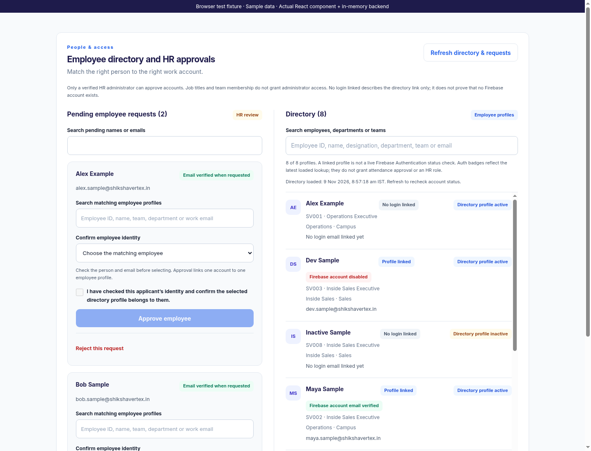
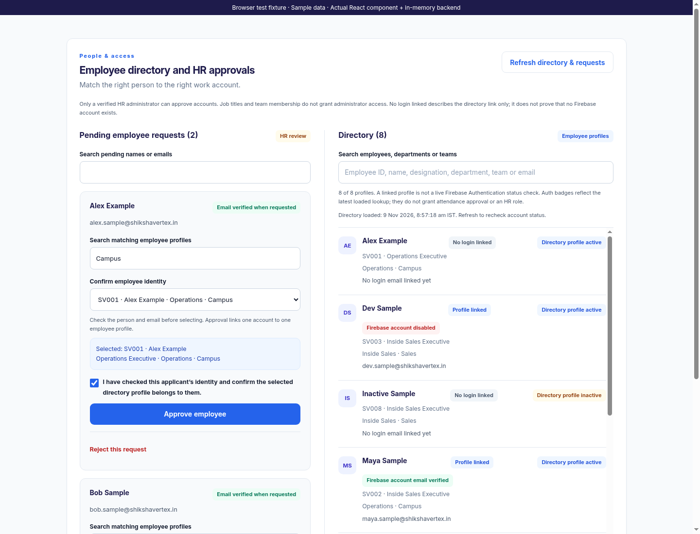
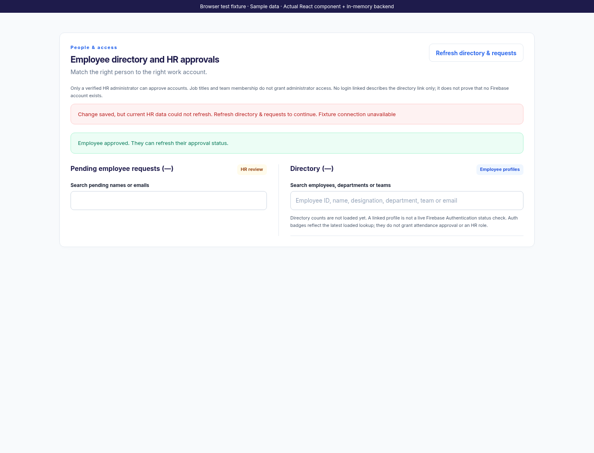
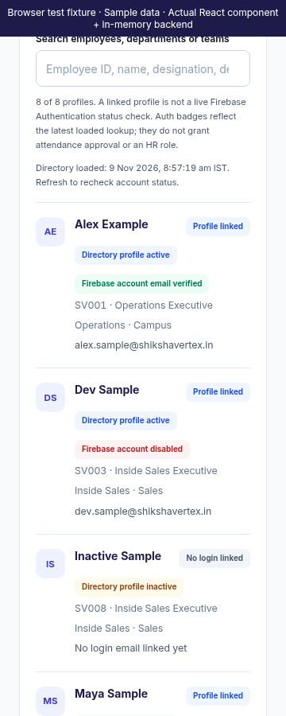

# Web Employee Directory and Approvals

This iteration finishes the existing `EmployeeAdministration` screen. Authentication, HR authorization and approval endpoints are preserved. The employee registration screen is unchanged. No deployment or APK build was performed.

Directory search includes employee ID, name, designation, department, team and linked email. Search ignores case and supports multiple terms across fields. Pending-request search remains separate. Counts and empty states refer to successfully loaded data; malformed or failed responses show unavailable data rather than an empty queue.

Directory links, directory activity and Firebase account status are separate indicators. “No login linked” describes the directory record and does not prove that no Firebase account exists. Verified, unverified, disabled and missing account badges require an explicitly checked backend lookup. Unknown or unchecked metadata never creates a verified badge. A checked email mismatch has its own warning. The displayed directory-loaded time is a completed snapshot load in India time, not a live verification timestamp. Refresh rechecks the snapshot. Job titles and status badges do not grant attendance or HR access.

Approval requires a selected active, compatible employee profile and explicit confirmation that HR checked the applicant’s identity. Profile options include employee IDs; the selected profile summary shows its role, department and team. Changing the matching search clears selection and confirmation. The email badge says “verified when requested,” reflecting the request snapshot rather than claiming current verification. Existing server approval checks remain authoritative. Rejection requires a reason.

Refresh clears stale profiles and mutation controls. A confirmed saved decision followed by a failed reload shows both outcomes distinctly and asks HR to refresh. An uncertain failed decision also clears old action controls rather than inviting a duplicate action. Out-of-order or unmounted load responses are ignored.

Validation passed: all 80 frontend tests across nine suites, 40 targeted backend tests, the production web build and `git diff --check`. Regression tests cover malformed snapshots, unchecked Auth metadata, employee-ID/multi-field search, incompatible profile bindings, confirmation reset and saved-decision refresh failures.

Chromium exercised the actual React component with the actual Express approval routes, an in-memory database and fixture Admin SDK responses. It checked account indicators, matching, approval, failure recovery and a 360px layout without document overflow. Screenshots are browser captures with labelled fictional sample data. No live Firebase records were read or changed, no real emails were sent, and live Firebase integration is not claimed by these fixture tests.
