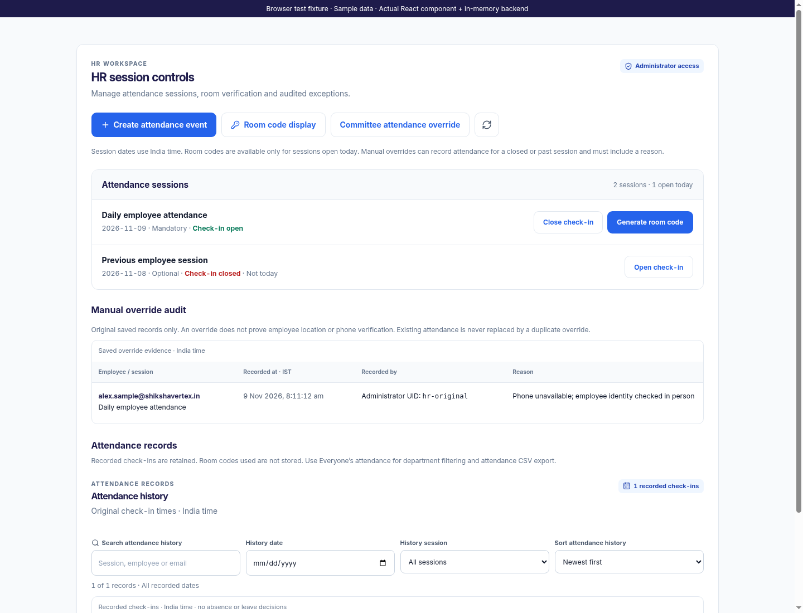
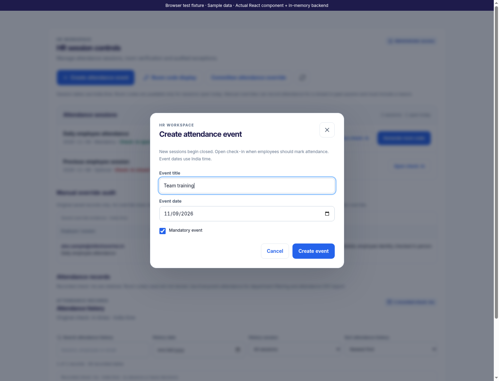
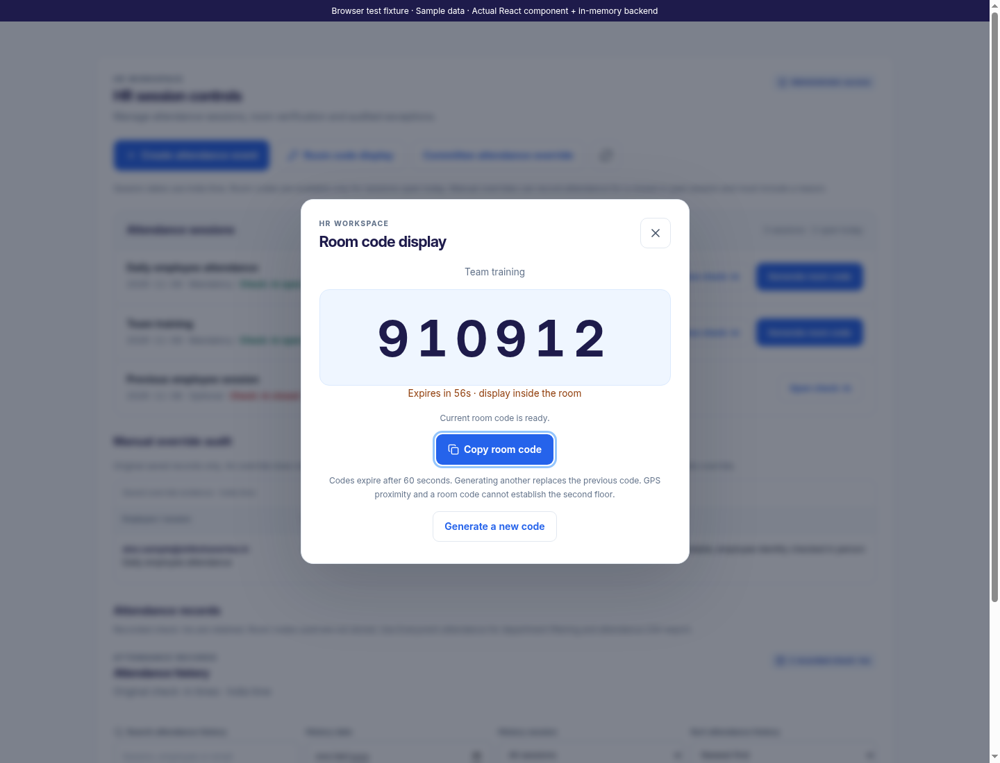
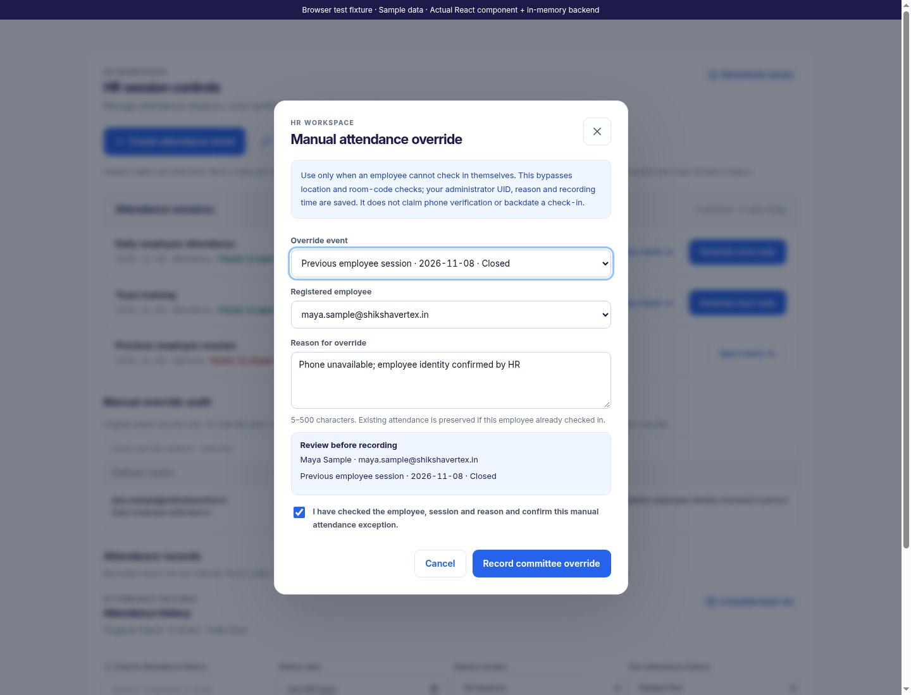
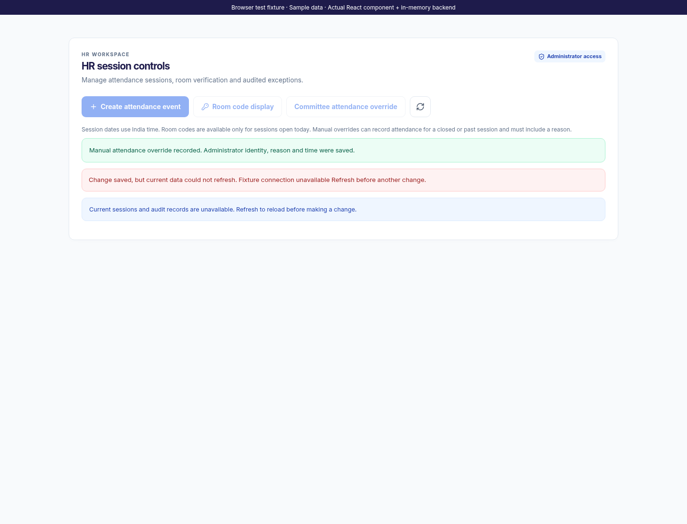
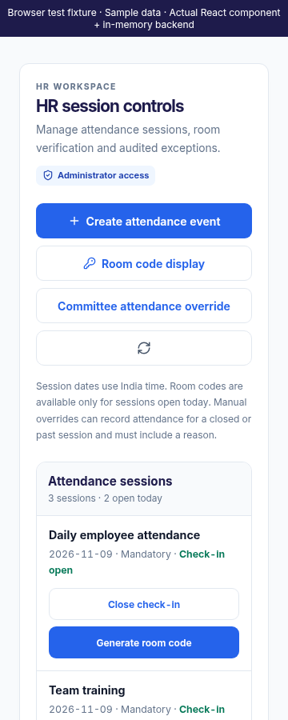
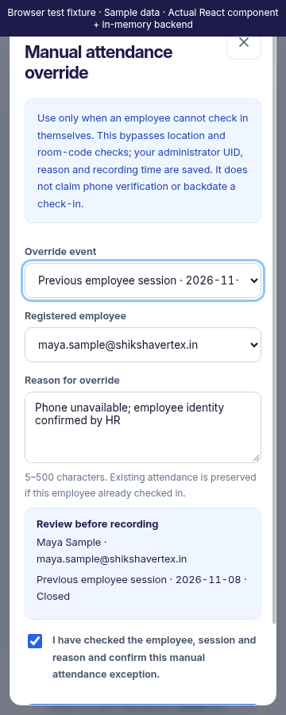

# Web HR Session Controls

This iteration finishes only the existing `HrCommandCenter` screen. The existing HR-only rendering, server authorization and event, room-code, registered-account and manual-attendance APIs are preserved. No server routes, authentication rules or stored-record formats changed. The shared My Attendance History component is unchanged.

Event creation validates the title and calendar date, supports the existing mandatory flag and confirms that the server created a closed session. Open and close actions send an explicit desired check-in state. Dates and eligibility for room codes use India time. Sessions on another date are labelled “Not today”; opening them does not make them eligible for today's self check-in. Mutation controls wait for the refreshed snapshot instead of optimistically changing the loaded sessions.

The room selector includes only sessions open today. The displayed six-digit code and expiry come from the server, with a countdown and copy feedback. Codes disappear on expiry, session closure, a date change, setup-mode changes or failed regeneration. Generating another replaces the previous code. Copy checks expiry again at the moment of use and provides manual-copy guidance if the clipboard is unavailable. Codes do not prove a particular floor, and used codes are not invented in attendance history. Dialogs trap keyboard focus, focus the new content after a view transition and restore focus when closed.

Manual overrides load fresh registered accounts whenever the dialog opens. Only explicit server-reported attendance eligibility permits selection; viewer-only accounts are excluded and incomplete account responses show an error. Failed or dismissed lookups cannot repopulate old choices. The administrator selects a session and employee, supplies a 5–500 character reason and explicitly confirms the employee, session and exception. Changing any of those fields clears confirmation. A review summary shows the exact target email and session date/state. The existing API allows closed or past sessions; this does not backdate the recording time. Browser overrides remain disabled when Wi-Fi attendance enforcement is enabled.

Confirmed new overrides report that the administrator identity, reason and time were saved. An `alreadyMarked` response instead says the original record was preserved and no new override was recorded. The audit table displays persisted administrator UID, reason, target email, session and original India-time timestamp. Missing legacy evidence is labelled unavailable, never filled from the currently logged-in administrator. This is the existing attendance-record audit evidence, not an additional immutable audit-log service.

A saved change followed by a failed refresh keeps the save confirmation separate from the reload error. Old sessions and audit records are hidden and further mutations wait for an explicit refresh. Failed or unconfirmed mutation outcomes also require refresh before another change. Invalid session/record snapshots show unavailable data rather than a false empty list. Immediate request locking prevents duplicate clicks while a write is pending.

Validation passed: all 90 frontend tests across nine suites, 35 existing backend route tests, the production web build with CI warnings treated as errors and `git diff --check`. Focused regressions cover eligibility, late account responses, confirmation reset, duplicate preservation, saved-write refresh failures, room expiry/date changes and original audit evidence. The App integration fixture was updated to use today's India date, explicit account eligibility and the actual manual-attendance response contract.

Chromium exercised the actual React component and Express routes against an in-memory database: event creation and opening, room generation/copy/expiry, a confirmed past-session override, duplicate preservation, saved-write refresh failure and recovery. At 360px, controls and dialogs fit the viewport and wide audit tables scroll inside their labelled region. Screenshots use labelled fictional records. No live Firebase/email calls, deployment or APK build occurred; these fixture checks do not claim live Firebase integration validation.
