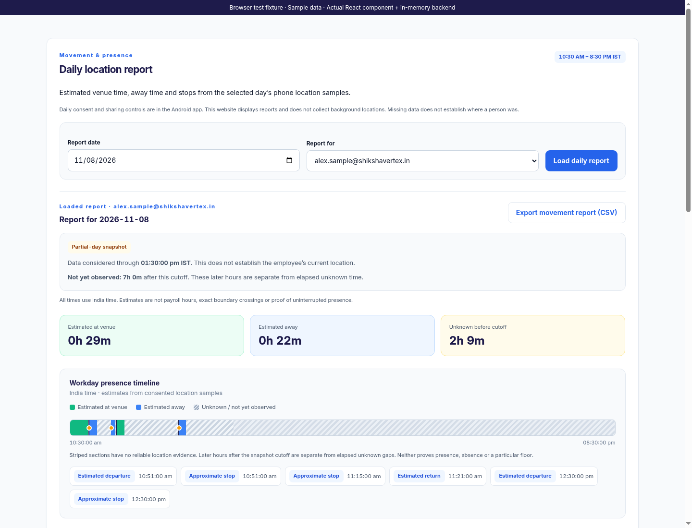
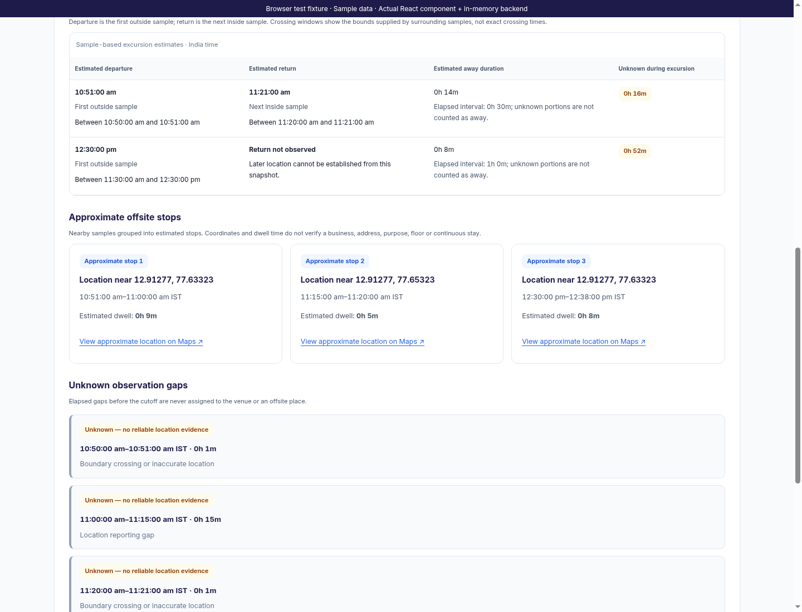
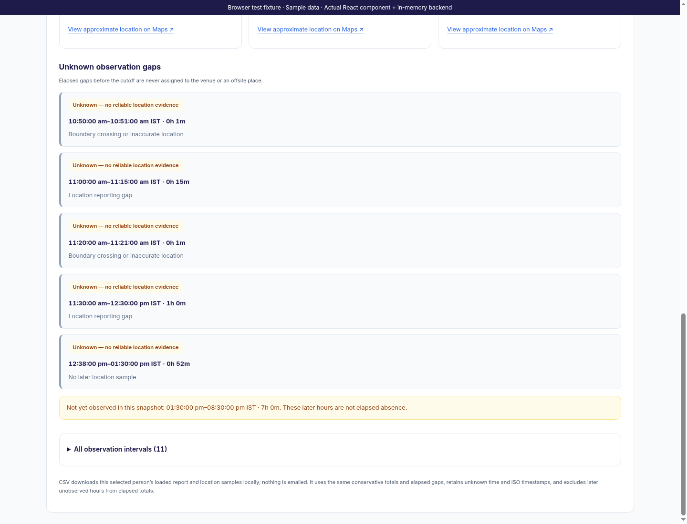
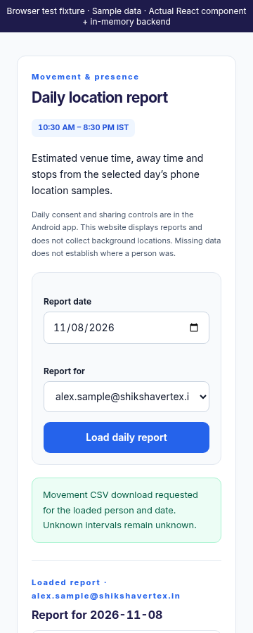
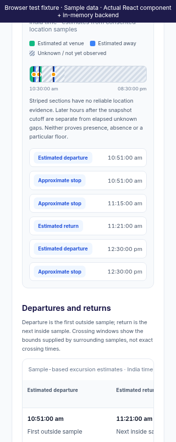
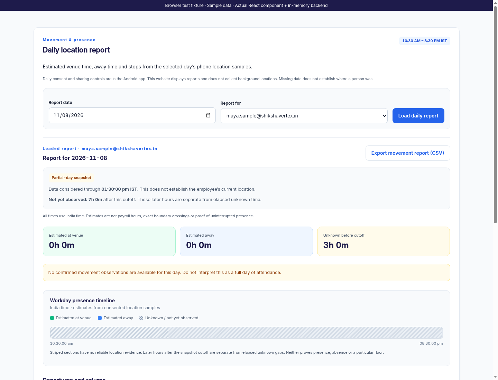
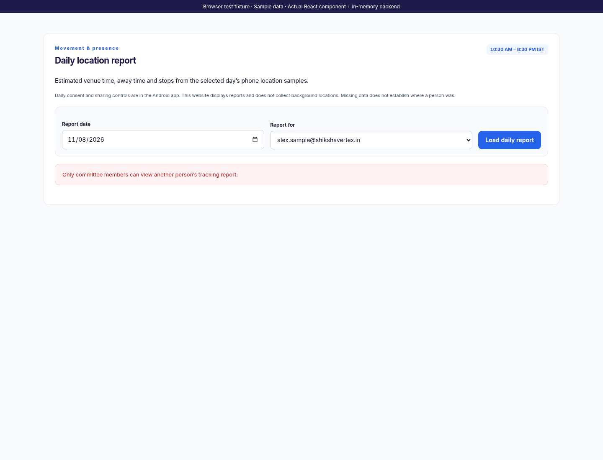

# Web Movement Report

This iteration finishes only the existing web `DailyReport` screen and its movement presentation helper/styles. Authentication, employee-own-report access, explicit HR subject selection and existing tracking APIs are preserved. Read-only attendance access does not grant movement history. Android screens, location collection and server algorithms are unchanged. No deployment or APK build occurred.

The summary, full-workday chart, interval list and movement CSV now share one conservative timeline projection. Estimated venue and away time require supporting intervals. Uncovered or conflicting intervals remain unknown. The report must identify the selected person and date, the India timezone, the 10:30–20:30 window and an explicit valid observation cutoff. Missing cutoff data never implies a fully observed day. Malformed or mismatched reports are unavailable and cannot be exported.

The summary's unknown duration covers elapsed time before the snapshot cutoff. Later hours are separately labelled “Not yet observed in this snapshot” and remain striped on the full-day chart; they are not added to elapsed unknown totals or interpreted as absence. Partial snapshots and ended day windows have distinct labels. An ended window does not imply complete evidence. Summary/export normalization is disclosed if supplied totals or intervals conflict with the conservative projection.

Departures and returns show first outside/next inside samples, with the crossing bounds supplied by surrounding observations. Without an earlier venue sample, departure is explicitly unbounded. Without a later inside sample, return remains “Return not observed”; later location is not inferred. Estimated away duration excludes unknown portions of the excursion, which are shown separately from elapsed duration.

Stops show approximate coordinates, sample interval and estimated dwell duration. Links are constructed from validated latitude/longitude and always use HTTPS Maps URLs; supplied labels or links cannot invent a named business. Invalid stop coordinates are unavailable and are omitted from the export projection. A stop is not proof of a business visit, purpose, floor or uninterrupted stay.

Unknown gaps have their own visible section with interval, duration and reason. They are no longer discoverable only by hovering the chart. A text list of every projected interval is available in a disclosure, and the chart's accessible description summarizes the same durations. The chart and tables use the existing Inter, indigo/royal-blue, green estimate and amber unknown palette.

Selection changes immediately hide the old report/export and invalidate pending results. Role changes also invalidate the loaded view. HR account choices require a valid registered-account response; a failed account list never fabricates choices and HR can still attempt their own report. Permission errors or a response for another person clear the result. The website does not call geolocation or start background collection.

Movement CSV remains a local export of the selected loaded person's report and location samples. It now uses the same normalized totals, elapsed gaps and excursion durations as the screen. Later unobserved hours remain outside elapsed totals. Existing formula-neutralizing CSV serialization and ISO timestamps are retained. Nothing is emailed.

Validation passed: all 111 frontend tests across nine suites, 46 backend route/tracking tests, the production web build with CI warnings treated as errors and `git diff --check`. Focused regressions cover partial-day gaps, missing cutoff/foreign identity, overlapping states, missing returns, invalid coordinates, role changes, roster failures and CSV/summary consistency.

Chromium exercised the actual React component with the actual Express tracking report routes and an in-memory database. Fictional consented samples produced 29 minutes estimated at venue, 22 minutes estimated away, 2 hours 9 minutes elapsed unknown and 7 hours not yet observed. It verified departure/return bounds, a missing return, three approximate stops, gap reasons, a downloaded CSV with matching subject/totals, empty evidence, foreign-response rejection and server permission revocation. At 360px, the page fits and wide excursion tables scroll inside a labelled keyboard-focusable region.

All previews are labelled browser captures of the actual component with sample data. No live Firebase/email calls or real employee changes occurred. Fixture checks do not claim live Firebase or physical phone validation.
