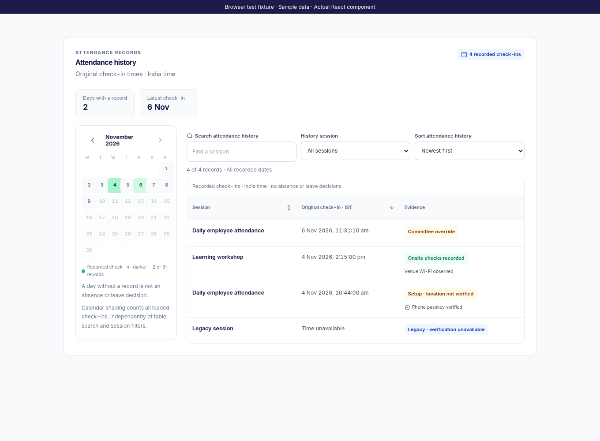
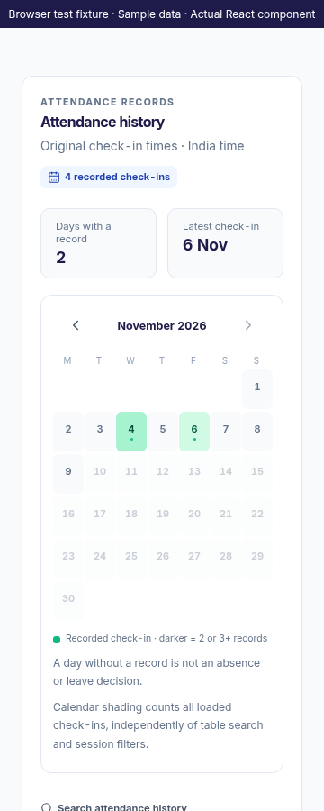
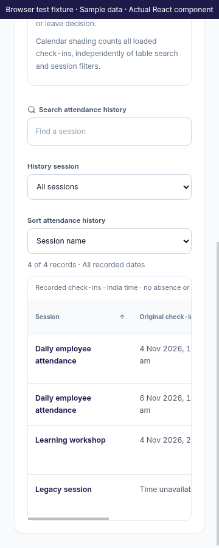

# Web My Attendance History

This iteration finishes only the existing `AttendanceHistory` component and its scoped history styles. The personal page still receives `ownLogs` from the existing authenticated App flow; no attendance API, authorization rule or stored record is changed. The component makes no network requests and contains no attendance-editing or approval actions.

The record calendar now stays visible when history is empty. Green shading distinguishes one, two and three-or-more recorded check-ins; it does not measure work time or presence. Selecting a date filters the table, selecting it again clears that date, and month navigation clears the date selection. This month returns directly to the current India month. Future dates are disabled. The table explicitly labels All recorded dates when no date is selected; changing the calendar month alone does not impose an implicit month filter.

Calendar counts describe all loaded records, independently of table search/session filters. Days without a record are never labelled absent or on leave. Records with an unavailable timestamp remain in the table without being assigned a fabricated calendar day.

Both Session and Original check-in column headings now sort in either direction using real buttons with `aria-sort`; the existing sort dropdown remains available. Timestamp sorting uses the original instants and keeps unavailable values at the end. Time display includes seconds and uses India time. Search, session/date filtering, result counts and Clear history filters remain local view operations. The table's labelled, keyboard-focusable scroll region contains horizontal scrolling on narrow screens.

Timestamp parsing accepts valid Date/epoch/ISO/Firestore timestamp representations. Booleans, ambiguous date strings and malformed dates do not turn into 1970 dates or invented calendar entries. Legacy/unavailable evidence is distinguished from setup, onsite and committee override records. Phone/Wi-Fi badges still require their corresponding persisted evidence; raw credentials, coordinates and network identifiers are not rendered.

Validation passed: all 75 frontend tests across nine suites and the production web build. Added tests cover the empty calendar, header sort directions and unavailable values, count shading independent of session filtering, month return/reset and malformed/Firestore timestamps. One App integration assertion was scoped to the actual attendance-success message because empty history now also supplies its own status announcement.

Chromium tested the actual React component with labelled fictional fixtures at desktop and 360px widths: calendar filtering, original-time/session sorting, missing timestamps, month return, empty history, contained mobile table scrolling and private-field omission. No API calls occurred in that fixture. These images are actual component browser captures with sample data, not live employee records or native phone screenshots. No deployment or APK build was performed.
