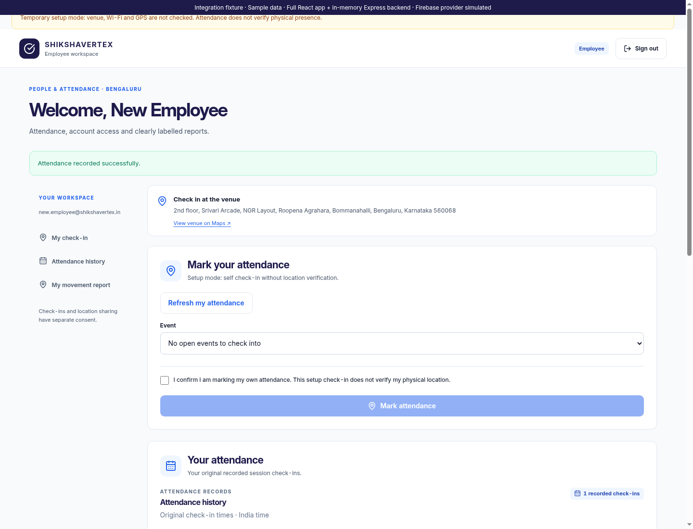
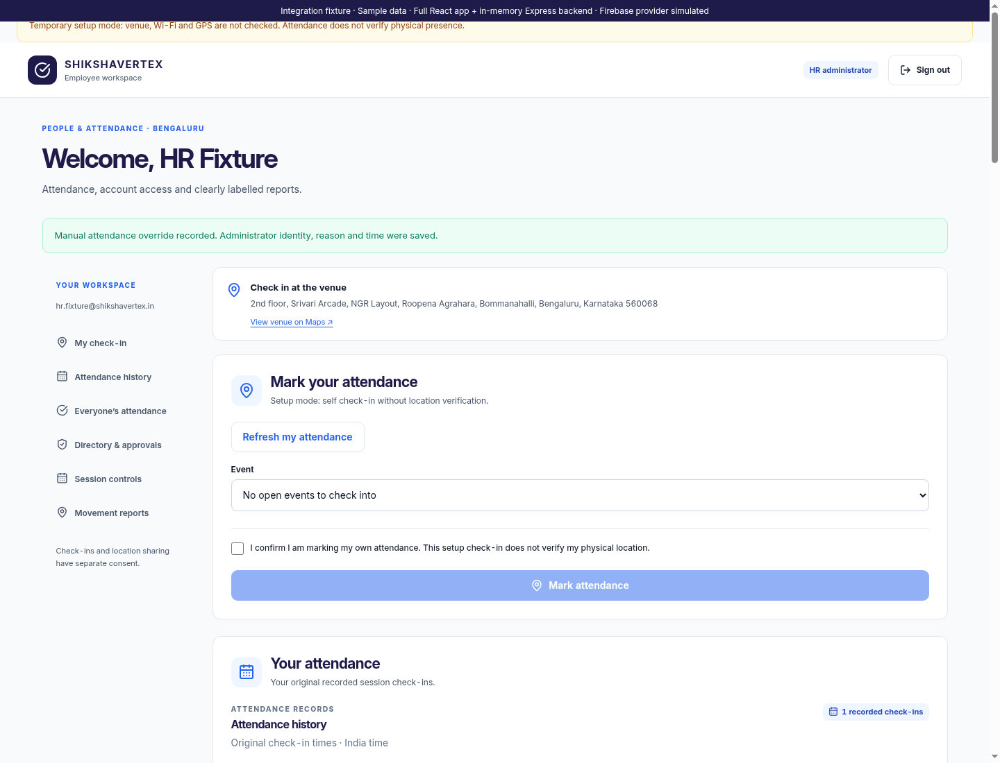
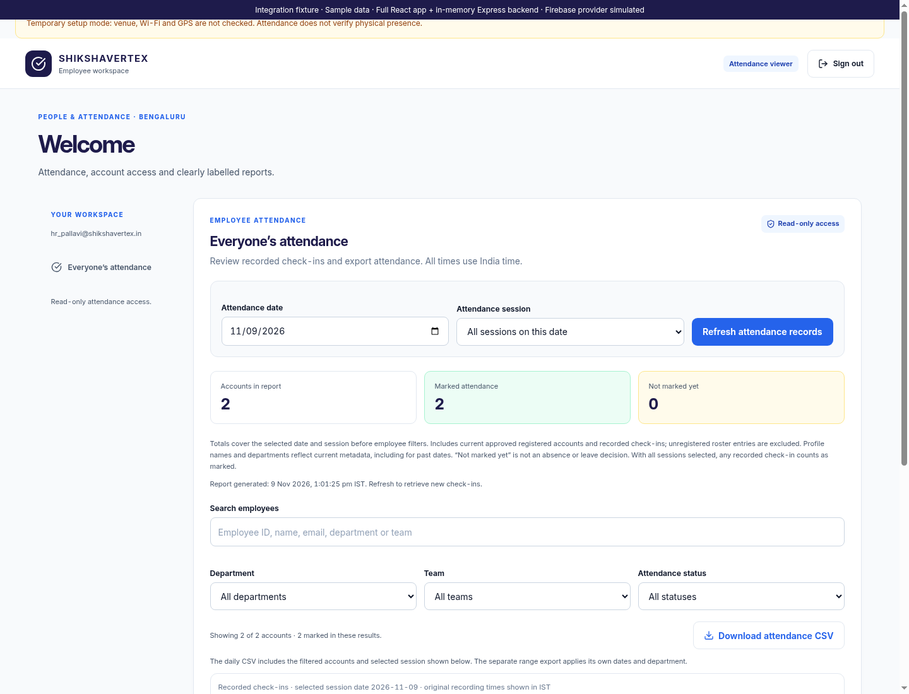
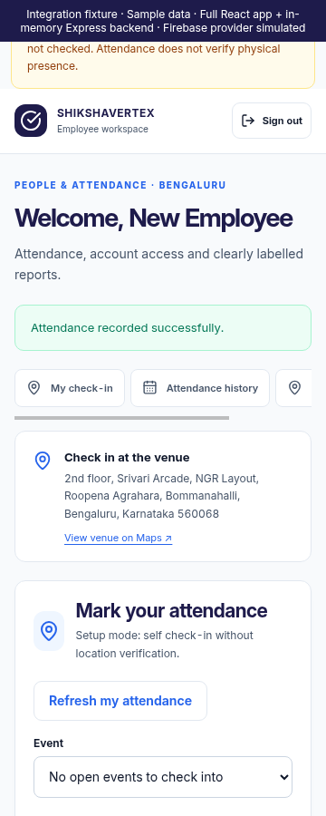

# Completed interface integration review

**Signing update:** The owner later approved a new-key/reinstall migration. The original-key blocker below is historical; [Android 1.7 signing setup](android-signing-setup.md) is the current procedure. Server certificate matching and physical-phone acceptance still apply.

Review branch: `codex/remaining-enterprise-views`. This branch contains the completed Android and web interface work, integration fixes and a repeatable review workflow. It does not deploy the service, merge into main or publish an APK. The per-screen reviews and previews are indexed in [design/README.md](design/README.md).

## Integration fixes

- Web attendance check-in keeps the confirmed server receipt in personal history even when the subsequent shared refresh fails. The saved result is reported separately from the refresh error, and another check-in waits for a successful refresh. The explicit **Refresh my attendance** action also lets employees discover sessions HR opens after login. Past/future sessions are excluded from self check-in, and submission rechecks the India date.
- HR session changes refresh the all-employees report while preserving local employee filters. A saved approval invalidates the reporting cohort and refreshes the HR movement-report account choices. Known writes invalidate the relevant reports even when the following load fails. Shared refresh responses are sequenced so an older response cannot replace a newer one.
- Android dashboard navigation now mounts the existing `MovementReportScreen` rather than the legacy text dialog. The view has Back, Refresh and safe Maps actions, checked account/date/window/cutoff metadata and explicit unknown-gap intervals. Elapsed unknown gaps and later unobserved time remain separate. Phone sign-in, passkeys, Wi-Fi enforcement and sharing consent still use the existing APIs and permissions.
- Review CI runs web/API and Android compile/unit/lint checks without any APK assembly or release signing. The original APK publication workflow and its signature guard remain intact.

## Checks completed

| Check | Result |
| --- | --- |
| Frontend unit/integration suites | 114 tests, 9 suites passed |
| Backend tests | All 79 passed |
| Production React build | Passed with CI warnings treated as errors |
| Full-app Chromium journey | Passed for independent HR, employee and read-only viewer contexts |
| Android Kotlin compilation and unit tests | Passed; 50 tests, zero failures |
| Android lint | Zero errors, 13 warnings |
| Diff whitespace checks | Passed |

The full browser journey mounts the actual `App`, venue gate, Axios client and completed screens against the real Express routes with an in-memory database. It exercises registration request → explicit HR profile approval → employee check-in → personal history; shared session/cohort/member-list refresh; duplicate-preserving manual overrides and their audit record; no-observation movement reports; viewer-only scope and revocation; and sign-out with the first-account binding retained. Whole employee, HR and viewer workspaces fit at 360px as well as desktop width.

Only the Firebase Auth provider is simulated in that journey. Biometrics are disabled only in its in-memory setup-mode fixture; existing backend tests separately verify signed WebAuthn assertions, replay/expiry, gates and authorization. These checks do not establish real email delivery, production Firebase access, hardware passkeys, GPS/Wi-Fi observations or Android background behavior. No live employee/attendance records or emails were changed.

Run the checks after installing the existing lockfiles:

```sh
npm ci --prefix server
npm ci --prefix client
npm test --prefix server
CI=true npm test --prefix client -- --watchAll=false --runInBand
CI=true npm run build --prefix client
npm run test:integration --prefix client
cd mobile/android
bash gradlew --no-daemon :app:compileDebugKotlin :app:testDebugUnitTest :app:lintDebug
```

The browser check needs Chrome/Chromium installed, or `CHROME_BIN` pointing to it. `INTEGRATION_SCREENSHOTS=docs/design/images` optionally captures labelled sample-data previews. Android checks need JDK 17+ and SDK/build-tools 35. Local validation used the cached JDK 21 / Gradle 8.9 toolchain, JVM target 17, with SDK 35. None of these Gradle tasks assembles an app APK.

## Remaining deployment and signing blockers

1. **Review/merge and deploy remain separate.** This branch must be reviewed before a production rollout. The live service's public health endpoint returned HTTP 200/status `ok` on 9 November 2026, and its homepage serves an existing bundle. This does not show that this branch or its Firebase integrations are deployed. Public health does not check real employee data or email delivery.
2. **Build the web app as well as the API.** With repository-root commands, Render build is `npm ci --prefix server && npm ci --prefix client && npm run build --prefix client`, start `npm start --prefix server`. If Render Root Directory remains `server`, equivalent build is `npm ci && npm ci --prefix ../client && npm run build --prefix ../client`, start `node server.js`. The server serves `client/build` when present. The earlier `server` / `npm ci` build alone does not build the updated frontend.
3. **Confirm production configuration privately.** Build-time public web values are `REACT_APP_FIREBASE_API_KEY`, `REACT_APP_FIREBASE_AUTH_DOMAIN` and `REACT_APP_FIREBASE_PROJECT_ID`. No local web configuration file was present; the production Firebase settings were not authenticated or changed during this review. Server Admin credentials remain runtime secrets; verify Auth provider, authorized domains, Firestore access/rules, stable cookie secret, HTTPS/proxy, RP/origins and chosen attendance policy before rollout. Use a paid/non-sleeping service if immediate all-day availability is required; Render Free can sleep. The temporary setup policy intentionally does not verify physical presence.
4. **The original Android private signing key is still required for an in-place update.** The existing workflow expects version 1.2's `D72678D6992A09AC549983C370851FCAB3F6635BB3BB727FC6F7DDADFF433D25` certificate. A debug cache or certificate file cannot reconstruct its private keystore. The guard is retained. Restore that key through secure signing configuration or deliberately plan a separate migration with the owner; no silent key rotation, uninstall or binding/passkey reset was performed. Release signing is not configured in source.
5. **Reconcile signing and hosted passkey association.** The public live `/.well-known/assetlinks.json` read advertised package `in.shikshavertex.attendance` with SHA-256 `49:CA:27:EB:60:DB:4E:0E:99:3F:73:8A:8B:40:53:86:FD:8B:76:AE:34:5F:15:60:B3:EF:D4:59:9F:FE:21:9D`, which differs from the retained update guard. Confirm the actual installed APK's certificate, available private keystore, Render fingerprint settings and exact Android WebAuthn origin before a signed rollout. Neither the hosted public certificate nor the checked-in fallback proves possession of an update key.
6. **Physical-phone acceptance remains.** Test on the Samsung SM-E546B/DS / Android 16: keyboard/system insets and large fonts, account verification and recovery, actual passkey enrollment/cancellation/assertions, setup/onsite policy changes, Wi-Fi loss, location permissions, explicit sharing consent and notification, Stop Sharing/sign-out, background/force-stop/network loss, 20:30 cutoff and next-day consent. Report gaps must stay unknown. No floor-detection equipment has been configured, so GPS, an SSID and room code do not prove the second floor.

## Whole-app previews

These are actual browser captures with fictional records and a simulated Firebase provider, not production or native-phone screenshots.








